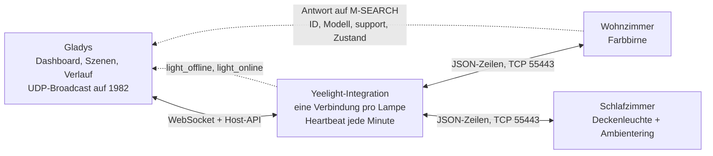
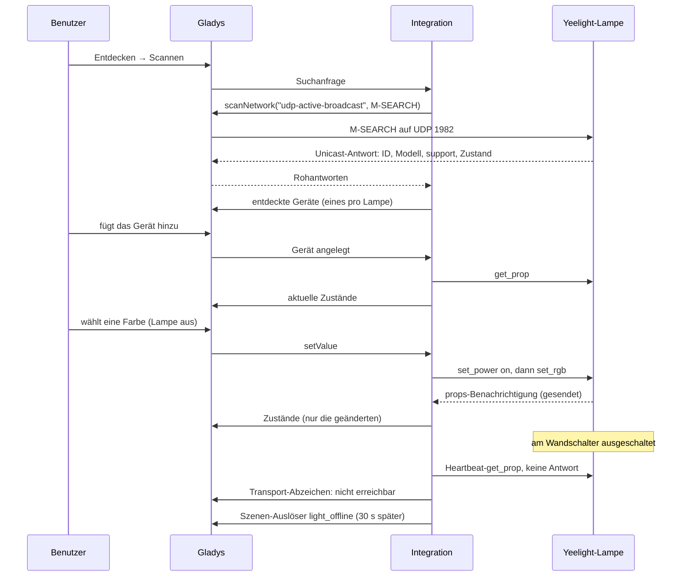
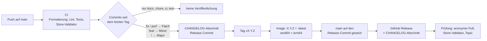

[English](README.md) · [Français](README.fr.md) · **Deutsch** · [Español](README.es.md)

# gladys-yeelight

[](LICENSE)
[](https://github.com/William-De71/gladys-yeelight/releases)
[](https://github.com/William-De71/gladys-yeelight/actions/workflows/release.yml)
[](https://gladysassistant.com)


Externe [Gladys Assistant](https://gladysassistant.com)-Integration für **Yeelight**-WLAN-Lampen — Glühbirnen, LED-Streifen, Nachttischlampen und Deckenleuchten — im lokalen Netzwerk. Mit einem Klick aus dem Store installiert, spricht sie über das offizielle LAN-Steuerprotokoll von Yeelight direkt mit Ihren Lampen: kein Cloud-Konto, kein Gateway, keine Laufzeitabhängigkeit außer dem [Gladys-Integrations-SDK](https://github.com/GladysAssistant/integration-sdk-js). Die Lampen werden durch eine Netzwerksuche gefunden, ihre Funktionen folgen dem, was jede Firmware meldet, und jede Zustandsänderung erreicht Gladys in dem Moment, in dem sie geschieht — Wandschalter und Yeelight-App eingeschlossen.

📖 Benutzerdokumentation: [English](docs/en.md) — [Français](docs/fr.md) — [Deutsch](docs/de.md) — [Español](docs/es.md)

> **Voraussetzung:** „LAN-Steuerung“ muss auf jeder Lampe in der Yeelight-App aktiviert sein. Eine Lampe ohne diese Option lehnt jeden lokalen Befehl ab und ist nicht auffindbar. Das ist die häufigste Ursache für „keine Lampe gefunden“.

## Funktionen

- **Automatische Suche**: Eine einzige Suche findet jede Lampe des Subnetzes, mit Name, Modell, Fähigkeiten und aktuellem Zustand; nichts einzutippen.
- **Funktionen aus der Firmware gelesen**: Ein/Aus, Helligkeit, Farbe, Farbtemperatur, Ambientelicht und Nachtlicht, nur angelegt, wenn die Lampe sie meldet (Tabelle unten).
- **Echtzeit**: Die Lampen senden ihre Änderungen über eine offen gehaltene Verbindung; nur die geänderten Werte gehen an Gladys.
- **Wandschalter erkannt**: Eine am Wandschalter ausgeschaltete Lampe erscheint innerhalb von ein bis zwei Minuten als nicht erreichbar und kommt von selbst zurück.
- **Szenen**: Starten Sie eine Szene, wenn eine Lampe offline geht oder zurückkommt, und spielen Sie aus einer Szene einen Lichteffekt ab — Sonnenaufgang, Sonnenuntergang, Alarm, Benachrichtigung, Kerze.
- **Schont die Lampen**: eine Verbindung pro Lampe und ein selbst auferlegtes Befehlskontingent, unterhalb der Grenzen des Protokolls.
- **Vier Sprachen**: Englisch, Französisch, Deutsch und Spanisch, in Gladys wie in der Dokumentation.

## Funktionsweise




Von der Suche zu einem Befehl, einem Zustand und einer Szene:



### Suche: warum kein SSDP


Yeelight verwendet ein SSDP-_ähnliches_ Protokoll auf **Port 1982**, nicht Standard-SSDP auf 1900 — die Spezifikation erklärt, man habe 1900 verlassen, um batteriebetriebenen Geräten die Flut an generischem Multicast zu ersparen. Der generische `ssdp`-Scanner des Cores würde also nie eine Lampe sehen.

Die Suche läuft stattdessen über die Erfassung `udp-active-broadcast`: Die Integration erzeugt das M-SEARCH, der Core sendet es aus dem Netzwerk des Hosts (ein Container im Bridge-Modus kann das nicht) und leitet die rohen Unicast-Antworten weiter.

```json
"network_discovery": [{ "type": "udp-active-broadcast", "ports": [1982] }]
```

Eine einzige Antwort enthält bereits die ID, das Modell, die `support`-Liste **und** den vollständigen Zustand: Eine Suche allein erzeugt also ein vollständiges Gerät, ohne TCP-Umweg.

Lampen in einem anderen Subnetz oder VLAN — die kein Broadcast erreicht — werden manuell eingetragen und über TCP abgefragt. Die Werks-ID lässt sich so nicht lesen: Eine solche Lampe wird an ihrer Adresse erkannt (`manual-<ip>`), und die Dokumentation verlangt eine DHCP-Reservierung. Eine manuell eingetragene Adresse, die auch die Suche gefunden hat, wird nicht abgefragt: Die Identität aus der Suche gewinnt, und die Lampe erscheint nur einmal.

### Befehle und Grenzen des Protokolls


Drei Grenzen der Spezifikation prägen den Code, und alle drei scheitern _stillschweigend_, wenn man sie überschreitet:

- **4 gleichzeitige Verbindungen** pro Lampe — daher eine einzige geteilte Verbindung pro Lampe, nie eine pro Befehl. Gleichzeitige Aufrufer (Aktualisierung beim Start, Poll, Befehl, Szenen-Aktion) teilen sich die Verbindung, die gerade geöffnet wird, statt um mehrere zu konkurrieren;
- **60 Befehle pro Minute** pro Verbindung — durchgesetzt, indem die Lampe verstummt, nicht durch einen Fehler: Der Client begrenzt sich daher selbst über ein gleitendes Fenster (Schübe bleiben sofort, nur eine echte Flut wartet). Ein Reglerschritt kostet einen Befehl: Der Einschaltzustand wird aus den Benachrichtigungen zwischengespeichert, statt jedes Mal abgefragt zu werden;
- **Farbe, Temperatur und Helligkeit werden abgelehnt, solange die Lampe aus ist** — diese Befehle sind mit `requiresPower` markiert, und die Lampe wird zuerst eingeschaltet (bei Bedarf mit Verbindungsaufbau), aber nur, wenn sie wirklich aus ist, denn ein unnötiges `set_power` startet die Überblendung neu.

Einschaltbefehle werden nach der Überblendung zurückgelesen: Sie verändern Funktionen, die nichts meldet (ein Ambientering, der dem Hauptlicht folgt, das Nachtlicht, das die Helligkeit ändert).

## Unterstützte Lampen

Die Funktionen richten sich nach dem `support`-Header, den jede Lampe meldet, nicht nach einer fest codierten Modelltabelle: Ein Modell, das nach diesem Code erschienen ist, erhält also genau die Funktionen, die seine Firmware umsetzt. Das Modell bestimmt nur den Kelvin-Bereich des Temperaturreglers und die wenigen Firmwares, die bekanntermaßen eine Methode melden, die sie ignorieren.

| Fähigkeit                         | Name der Funktion in Gladys                  | Angelegt, wenn die Lampe meldet                     |
| --------------------------------- | -------------------------------------------- | --------------------------------------------------- |
| Ein / Aus                         | On/Off — Main light mit einem Ambientelicht  | immer                                               |
| Helligkeit (1-100 %)              | Brightness — Main brightness                 | `set_bright`                                        |
| Farbe (0xRRGGBB)                  | Colour — Main colour                         | `set_rgb`                                           |
| Farbtemperatur (Mired)            | Colour temperature — Main colour temperature | `set_ct_abx` — außer reinen RGB-Streifen (`strip6`) |
| Ambientelicht Ein / Aus           | Ambient light                                | `bg_set_power`                                      |
| Helligkeit des Ambientelichts     | Ambient brightness                           | `bg_set_bright`                                     |
| Farbe des Ambientelichts          | Ambient colour                               | `bg_set_rgb`                                        |
| Farbtemperatur des Ambientelichts | Ambient colour temperature                   | `bg_set_ct_abx`                                     |
| Nachtlicht (Mondlicht)            | Night light                                  | Deckenleuchten-Modelle                              |

Die Namen der Funktionen legt die Integration auf Englisch fest, unabhängig von der Sprache von Gladys; jede lässt sich in Gladys umbenennen. Die Farbtemperatur wird in **Mired** veröffentlicht, wie bei den Philips-Hue- und Tasmota-Integrationen des Cores: Gladys zeichnet den Regler mit einem Kalt→Warm-Verlauf, dem Mired folgt und dem Kelvin entgegenläuft. Die Werte werden an der Grenze umgerechnet, im Bereich des Modells (2700–6500 K bei einer Deckenleuchte, 1700–6500 K bei einer Farbbirne).

## Konfiguration

| Feld                        | Standard | Verwendung                                                                                                              |
| --------------------------- | -------- | ----------------------------------------------------------------------------------------------------------------------- |
| Übergangsdauer (ms)         | 500      | Überblendung bei jeder Änderung (0 bis 5000); 0 für einen sofortigen Wechsel                                            |
| Manuell hinzugefügte Lampen | leer     | `192.168.1.42`, `192.168.1.43:55443` oder `[fe80::1]`, durch Kommas getrennt, für eine Lampe außer Reichweite der Suche |
| Suchdauer (s)               | 5        | Wie lange die Suche auf Antworten wartet (3 bis 30)                                                                     |

Aktionen der Integrationsseite: **Verbindung testen** (eine vollständige Suche, mit der Zahl der Lampen und Funktionen) und **Lampen neu verbinden** (schließt jede Verbindung und öffnet sie neu, nach einem Stromausfall oder einer Änderung im Netzwerk).

## Transport

Yeelight ist ausschließlich lokal: Das Manifest gibt `"transports": ["local"]` an, und jedes Gerät trägt ein Transport-Abzeichen — **Lokal**, solange seine Lampe verbunden ist, **Nicht erreichbar**, solange sie es nicht ist.

Eine am Wandschalter ausgeschaltete Lampe schließt ihre TCP-Verbindung nie: Der Socket bleibt halb offen, und nichts kommt mehr an, sodass die Lampe ohne Prüfung stundenlang verbunden wirken würde. Ein **Heartbeat** fragt deshalb jede Verbindung, die seit einer Minute schweigt, nach ihrem Einschaltzustand — ein Befehl pro Minute und Lampe, bei einem Kontingent von 60. Kommt innerhalb von 5 Sekunden keine Antwort, wird die Verbindung getrennt: Das Abzeichen wechselt innerhalb von ein bis zwei Minuten auf **Nicht erreichbar**, und die Integration verbindet sich in wachsenden Abständen (von 5 Sekunden bis 5 Minuten) neu, bis die Lampe wieder Strom hat.

Die Zustände erreichen Gladys über die Benachrichtigungen der Lampen und werden mit `publishChangedStates` veröffentlicht: Ein unveränderter Wert wird verworfen (einmal pro Stunde erneut gesendet). Die von Ihnen angelegten Geräte werden beim Start und beim Hinzufügen einmal gelesen, da eine Lampe nur meldet, was sich _ändert_; `onPoll` ist nur ein Sicherheitsnetz, das eine Lampe mit abgebrochener Sitzung neu verbindet.

## Szenen

| Auslöser                     | Wann                                                                                        | Filter | Variablen                                     |
| ---------------------------- | ------------------------------------------------------------------------------------------- | ------ | --------------------------------------------- |
| Yeelight-Lampe offline       | Eine Lampe war 30 Sekunden lang nicht erreichbar (Wandschalter, Stromausfall, WLAN-Problem) | Lampe  | `light`, `name`, `address`                    |
| Yeelight-Lampe wieder online | Diese Lampe antwortet wieder                                                                | Lampe  | `light`, `name`, `address`, `offline_minutes` |

| Aktion                          | Felder                                                                   | Ausgaben     |
| ------------------------------- | ------------------------------------------------------------------------ | ------------ |
| Yeelight: Lichteffekt abspielen | Lampe, Effekt, Dauer in Minuten (1 bis 60, Sonnenaufgang und -untergang) | `light_name` |
| Yeelight: Lichteffekt stoppen   | Lampe                                                                    | `light_name` |

Die Auslöser betreffen nur die Lampen, die Sie zu Gladys hinzugefügt haben, und lösen einmal pro Übergang aus: Eine Lampe, die innerhalb von 30 Sekunden aus- und wieder eingeschaltet wird, löst nichts aus, und **wieder online** folgt nur auf ein ausgelöstes **offline**. Lassen Sie den Lampenfilter leer, um alle Lampen zu überwachen. Eine Szenen-Aktion löst nie einen Auslöser aus: Ein Effekt ändert die Zustände einer Lampe, nie ihre Erreichbarkeit.

| Effekt                             | Was die Lampe tut                                                                                   |
| ---------------------------------- | --------------------------------------------------------------------------------------------------- |
| Sonnenaufgang (bleibt an)          | Von tiefem Orange bei 1 % bis zu neutralem Weiß bei 100 %, über die gewählte Dauer; bleibt an       |
| Sonnenuntergang (endet aus)        | Von warmem Weiß bis zu tiefem Orange bei 1 %, über die gewählte Dauer; schaltet sich dann aus       |
| Alarm: rotes Blinken               | 10 rote Blitze (5 s), dann zurück in den vorherigen Zustand — oder aus, wenn sie aus war            |
| Benachrichtigung: blaues Pulsieren | 4 sanfte blaue Pulse (5 s), dann zurück in den vorherigen Zustand — oder aus, wenn sie aus war      |
| Kerze (bis zum Stoppen)            | Ein bernsteinfarbenes Flackern, bis **Yeelight: Lichteffekt stoppen** oder ein anderer Befehl kommt |

Der Effekt ist ein Yeelight-Farbablauf (`set_scene cf`): Er läuft in der Lampe selbst, sodass ein 30-minütiger Sonnenaufgang weiterläuft, auch wenn Gladys neu startet. Eine reine Weißlicht-Lampe (Deckenleuchte, Schreibtischlampe) spielt denselben Effekt in Farbtemperatur ab: ein kaltweißer Blitz für den Alarm, ein warmes Flackern für die Kerze.

Drei Szenen für den Anfang:

- **Mit der Sonne aufwachen**: Auslöser **Zeitabhängiger Auslöser** um 6:45 Uhr an Wochentagen; Aktion **Yeelight: Lichteffekt abspielen** mit Lampe `Schlafzimmer`, Effekt **Sonnenaufgang (bleibt an)**, Dauer `20`.
- **Eine am Wandschalter ausgeschaltete Lampe**: Auslöser **Yeelight-Lampe offline**, Lampe leer (alle Lampen); Aktion **Nachricht senden** „_Name der Lampe_ wurde am Wandschalter ausgeschaltet“, mit der eingefügten Variable **Name der Lampe**. Fügen Sie **Yeelight-Lampe wieder online** mit der Variable **Minuten offline** hinzu, um zu erfahren, wie lange sie aus war.
- **Eine dezente Benachrichtigung**: Auslöser **Änderung von Gerätestatus** auf der Steckdose der Waschmaschine, Leistung unter 5 W; Aktion **Yeelight: Lichteffekt abspielen** mit Lampe `Wohnzimmer`, Effekt **Benachrichtigung: blaues Pulsieren**. Eine ausgeschaltete Lampe schaltet sich danach wieder aus.

## Installation

1. In Gladys (**5.1.0 oder neuer**): **Integrationen → Store**, nach **Yeelight** suchen, installieren.
2. Aktivieren Sie in der Yeelight-App **LAN-Steuerung** auf jeder Lampe.
3. **Entdecken → Scannen**, dann die gewünschten Lampen hinzufügen.

Seit den Szenen-Auslösern und -Aktionen setzt die Integration Gladys 5.1.0 voraus: Ein älteres Gladys erhält ihre Updates nicht mehr und bleibt auf Version 1.3.0, bis Gladys selbst aktualisiert wird. Die [Benutzerdokumentation](docs/de.md) erläutert die Netzwerkvoraussetzungen, die manuell hinzugefügten Lampen, die Deckenleuchten mit Ambientering, die Szenen und die Fehlerbehebung.

## Entwicklung

```bash
npm install
GLADYS_HOST_API_URL="http://localhost:1443" \
GLADYS_INTEGRATION_TOKEN="<token>" \
npm start
```

```
index.js                     nur die SDK-Verdrahtung: createApp(new GladysIntegration()) + connect
src/
  app.js                     alle Handler (Suche, Befehle, Poll, Aktionen, Gerät angelegt)
  events.js                  Szenen-Auslöser: light_offline, light_online (30 s Karenzzeit)
  scenes.js                  Szenen-Aktionen: start_effect, stop_effect
  config.js                  Normalisierung der Konfiguration, manuell eingetragene Lampen, Adressen
  devices.js                 Suche, Veröffentlichung der Zustände (publishChangedStates), Befehle
  messages.js                Meldungen für den Benutzer, in en / fr / de / es
  yeelight/
    YeelightManager.js       eine aktive Verbindung pro Lampe, Wiederverbindung mit Backoff, Heartbeat
    YeelightClient.js        das LAN-Protokoll: Framing, Zuordnung, Kontingent
    discovery.js             Erzeugung des M-SEARCH und Auswertung der Antworten
    effects.js               Lichteffekte als Farbabläufe (set_scene cf)
    mapping.js               Fähigkeiten der Lampe -> Gladys-Funktionsbeschreibungen
    models.js                Auswertung der support-Liste, Kelvin-Bereiche pro Modell
    convert.js               Umrechnung der Werte, in beide Richtungen
    constants.js             Protokollkonstanten, Zeiten, Schema der externen Kennungen
```

Die Plattform-ID ist die **ID** der Lampe aus der Suche (`0x000000000015243f`), ab Werk fest eingebrannt. Eine IP-Adresse ist eine DHCP-Zuweisung und steht daher in einem Geräteparameter:

```
device : ext:<selector>:yeelight:<bulbId>
feature: ext:<selector>:yeelight:<bulbId>:<featureKey>
```

**Push statt Poll.** Yeelight-Lampen senden ihre Zustandsänderungen über die offen gehaltene Verbindung: Eine am Wandschalter oder in der Yeelight-App gedimmte Lampe aktualisiert Gladys sofort, und keine Funktion gibt eine `poll_frequency` an.

**Eine Lampe hat vier Verbindungsplätze.** Verbindungsversuche zu einer Lampe werden geteilt, eine von der Suche gefundene _und_ manuell eingetragene Lampe behält eine einzige Verbindung, und jede Verbindung wird beim Beenden geschlossen, wodurch ihr Platz sofort frei wird.

Der Steuerkanal ist Klartext, eine Lampe lässt sich während der Entwicklung also von Hand steuern:

```bash
telnet <lampen-ip> 55443
{"id":1,"method":"set_power","params":["on","smooth",500]}
```

## Tests

```bash
npm test               # node --test, berührt nie das Netzwerk
npm run lint           # ESLint
npm run format:check   # Prettier, wie die CI es ausführt
npx github:GladysAssistant/integration-store . --skip-image-check
```

`test/structure.test.js` vergleicht die Suche mit `test/fixtures/discovery.baseline.json`, erzeugt aus v1.3.0 mit einer Farbbirne, einer Deckenleuchte mit Ambientering und Nachtlicht, einem reinen RGB-Streifen, einer weißen Glühbirne und einer manuell hinzugefügten Lampe: Eine externe Kennung, eine Kategorie, ein Typ, eine Einheit oder eine Grenze, die sich ändert, würde die Benutzer zwingen, ihre Geräte neu anzulegen. `test/app.test.js` steuert die Handler mit dem Fake-Gladys des SDK, und `test/i18n.test.js` prüft die vier Sprachen des Manifests, der Meldungen, der Dokumentation und dieser READMEs.

## Veröffentlichung

Veröffentlichungen erfolgen automatisch. Jeder Push auf `main` startet die CI und berechnet dann die nächste Version aus den Conventional Commits seit dem letzten Tag:



Das Manifest erreicht `main` erst, wenn sein Image existiert, sodass der Store nie eine Version ankündigt, die er nicht herunterladen kann. `CHANGELOG.md` wird erzeugt: Bearbeiten Sie die Datei nie von Hand. **Actions → Release → Run workflow** bietet `release-as` (eine Version erzwingen) und `dry-run` (Version und Notizen anzeigen, ohne zu veröffentlichen).

Titel von Commits und Pull Requests folgen [Conventional Commits](https://www.conventionalcommits.org/), auf Englisch, formuliert als die Changelog-Zeile, die der Benutzer lesen wird: `feat(scenes): start a scene when a Yeelight light goes offline`. `feat` veröffentlicht eine Minor-Version, `fix` und `perf` einen Patch, `!` oder eine Fußzeile `BREAKING CHANGE:` eine Major-Version; `docs`, `chore`, `ci`, `test`, `style`, `refactor` und `build` allein veröffentlichen nichts.

Ist `main` geschützt (Branch-Schutzregel oder Ruleset), kann der Workflow den Branch nur dann auf den Release-Commit setzen, wenn **GitHub Actions** die Regel umgehen darf (Settings → Rules → Bypass list), oder mit dem Token einer GitHub App; andernfalls werden Tag und Image veröffentlicht, aber `main` bleibt zurück.

## Fehlerbehebung

| Symptom                                        | Wahrscheinliche Ursache                                                                                            |
| ---------------------------------------------- | ------------------------------------------------------------------------------------------------------------------ |
| Keine Lampe gefunden                           | „LAN-Steuerung“ ist in der Yeelight-App nicht aktiviert — das zuerst prüfen                                        |
| Nur eine von mehreren Lampen wird gefunden     | Die Option ist nur auf dieser Lampe aktiviert — sie wird Lampe für Lampe eingestellt                               |
| Eine Lampe wird von der Suche nie gefunden     | Sie liegt in einem anderen Subnetz oder VLAN als Gladys: Der Broadcast überquert keinen Router, manuell hinzufügen |
| Gerät „Nicht erreichbar“                       | Lampe am Wandschalter ausgeschaltet, stromlos oder außer WLAN-Reichweite: Sie verbindet sich von selbst neu        |
| Eine manuell hinzugefügte Lampe wird unbekannt | Ihre IP-Adresse hat sich geändert — geben Sie ihr eine feste Adresse in Ihrem Router                               |
| Befehle kommen nach einer Weile nicht mehr an  | Eine andere App belegt die 4 Verbindungen der Lampe oder verbraucht ihre 60 Befehle pro Minute                     |
| Die Effekt-Aktion schlägt fehl                 | Die Lampe unterstützt keine Effekte, oder sie ist in diesem Moment nicht erreichbar                                |

Protokolle: der Tab **Überwachung** der Integration; fügen Sie dem Container `DEBUG=gladys-integration-sdk` hinzu, um die Details des SDK zu sehen.

## Mitwirken

Issues und Pull Requests sind willkommen: [Fehlerbericht](https://github.com/William-De71/gladys-yeelight/issues/new?template=bug_report.yml) (Versionen von Gladys und der Integration, Modell und Firmware der Lampe, Protokolle) oder [Funktionswunsch](https://github.com/William-De71/gladys-yeelight/issues/new?template=feature_request.yml). Rückmeldungen und Fragen gehören auch in den [Forum-Thread](https://community.gladysassistant.com/t/10689). Sicherheitsprobleme: siehe [SECURITY.md](SECURITY.md).

Setzt die [Yeelight WiFi Light Inter-Operation Specification](https://www.yeelight.com/download/Yeelight_Inter-Operation_Spec.pdf) mit dem Node.js-Modul `net` um, und mit nichts anderem. Aufgebaut auf dem [Gladys-Integrations-SDK](https://github.com/GladysAssistant/integration-sdk-js), ausgehend von der [offiziellen Vorlage](https://github.com/GladysAssistant/integration-template-js).

## Lizenz

[Apache-2.0](LICENSE) — siehe auch [NOTICE](NOTICE). Yeelight ist eine Marke ihres Inhabers; dieses Projekt ist weder mit Yeelight oder Xiaomi verbunden noch von ihnen unterstützt oder gesponsert.
