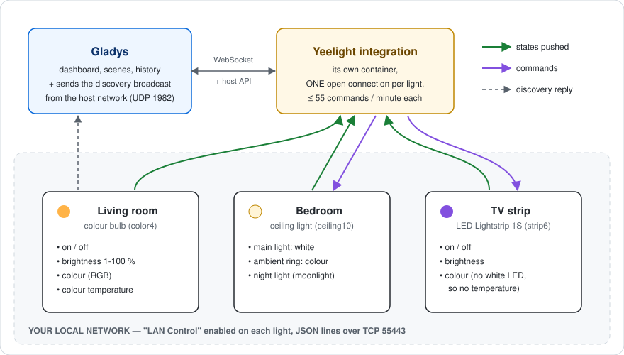
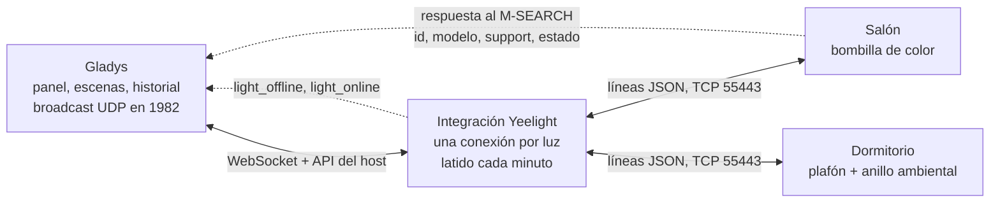
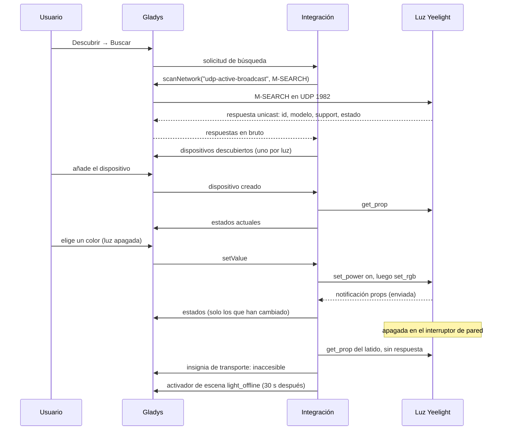
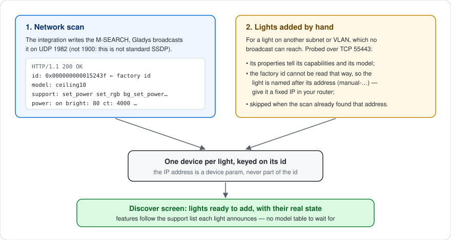
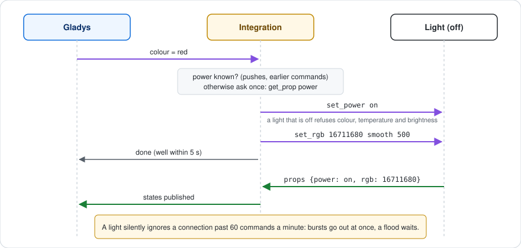
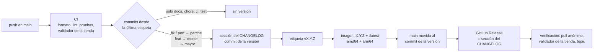

[English](README.md) · [Français](README.fr.md) · [Deutsch](README.de.md) · **Español**

# gladys-yeelight

[](LICENSE)
[](https://github.com/William-De71/gladys-yeelight/releases)
[](https://github.com/William-De71/gladys-yeelight/actions/workflows/release.yml)
[](https://gladysassistant.com)


Integración externa de [Gladys Assistant](https://gladysassistant.com) para las luces Wi-Fi **Yeelight** — bombillas, tiras LED, lámparas de mesita y plafones — en la red local. Instalada desde la tienda con un clic, habla directamente con sus luces mediante el protocolo oficial de control LAN de Yeelight: sin cuenta en la nube, sin pasarela, sin dependencias de ejecución aparte del [SDK de integraciones de Gladys](https://github.com/GladysAssistant/integration-sdk-js). Las luces se encuentran con una búsqueda en la red, sus funciones siguen lo que anuncia cada firmware, y cada cambio de estado llega a Gladys en el momento en que se produce — interruptor de pared y aplicación Yeelight incluidos.

📖 Documentación de usuario: [English](docs/en.md) — [Français](docs/fr.md) — [Deutsch](docs/de.md) — [Español](docs/es.md)

> **Requisito:** «Control LAN» debe estar activado en cada luz, en la aplicación Yeelight. Una luz sin esta opción rechaza cualquier comando local y no se puede descubrir. Es la primera causa de «no se encuentra ninguna luz».

## Funciones

- **Descubrimiento automático**: una sola búsqueda encuentra todas las luces de la subred, con su nombre, su modelo, sus capacidades y su estado actual; nada que escribir.
- **Funciones leídas del firmware**: encendido, brillo, color, temperatura de color, luz ambiental y luz nocturna, creadas solo si la luz las anuncia (tabla más abajo).
- **Tiempo real**: las luces envían sus cambios por una conexión que se mantiene abierta; solo los valores que han cambiado se envían a Gladys.
- **Interruptor de pared detectado**: una luz apagada en el interruptor aparece como inaccesible en uno o dos minutos, y vuelve sola.
- **Escenas**: inicie una escena cuando una luz se desconecta o vuelve, y reproduzca un efecto de luz desde una escena — amanecer, atardecer, alerta, notificación, vela.
- **Cuida las luces**: una conexión por luz y una cuota de comandos que la integración se impone, por debajo de los límites del protocolo.
- **Cuatro idiomas**: inglés, francés, alemán y español, en Gladys y en la documentación.

## Funcionamiento





De la búsqueda a un comando, un estado y una escena:



### Descubrimiento: por qué no SSDP



Yeelight usa un protocolo _parecido_ a SSDP en el **puerto 1982**, no el SSDP estándar en el 1900 — la especificación explica que dejaron el 1900 para ahorrar a los dispositivos con batería la avalancha de multicast genérico. El escáner `ssdp` genérico del core nunca vería, por tanto, una luz.

El descubrimiento pasa en cambio por la captura `udp-active-broadcast`: la integración construye el M-SEARCH, el core lo difunde desde la red del host (un contenedor en modo bridge no puede) y reenvía las respuestas unicast en bruto.

```json
"network_discovery": [{ "type": "udp-active-broadcast", "ports": [1982] }]
```

Una sola respuesta ya contiene el identificador, el modelo, la lista `support` **y** el estado completo, así que una búsqueda basta para construir un dispositivo completo, sin ida y vuelta TCP.

Las luces en otra subred o VLAN — a las que no llega ningún broadcast — se declaran a mano y se consultan por TCP. El identificador de fábrica no se puede leer así: una luz de este tipo se identifica por su dirección (`manual-<ip>`), y la documentación pide una reserva DHCP. Una dirección declarada a mano que la búsqueda también encontró no se consulta: gana la identidad de la búsqueda y la luz aparece una sola vez.

### Comandos y límites del protocolo



Tres límites de la especificación dan forma al código, y los tres fallan _en silencio_ cuando se superan:

- **4 conexiones simultáneas** por luz — de ahí una sola conexión compartida por luz, nunca una por comando. Los llamantes concurrentes (actualización al arrancar, poll, comando, acción de escena) comparten la conexión que se está abriendo en lugar de competir por abrir varias;
- **60 comandos por minuto** por conexión — impuestos por el silencio de la luz, no por un error: el cliente se limita por tanto a sí mismo en una ventana deslizante (las ráfagas siguen siendo instantáneas, solo una verdadera avalancha espera). Un paso del control deslizante cuesta un comando: el estado de encendido se guarda en caché a partir de las notificaciones en lugar de consultarse cada vez;
- **el color, la temperatura y el brillo se rechazan mientras la luz está apagada** — esos comandos llevan la marca `requiresPower`, y la luz se enciende primero (conectándose si hace falta), pero solo si está realmente apagada, porque un `set_power` innecesario relanza el fundido.

Los comandos de encendido se vuelven a leer tras el fundido: cambian funciones que nada notifica (un anillo ambiental que sigue a la luz principal, la luz nocturna que modifica el brillo).

## Luces compatibles

Las funciones dependen de la cabecera `support` que anuncia cada luz, no de una tabla de modelos escrita en el código: un modelo aparecido después de escribir este código obtiene exactamente las funciones que su firmware implementa. El modelo solo decide el rango en Kelvin del control de temperatura, y los pocos firmwares conocidos por anunciar un método que ignoran.

| Capacidad                      | Nombre de la función en Gladys               | Creada cuando la luz anuncia                       |
| ------------------------------ | -------------------------------------------- | -------------------------------------------------- |
| Encender / apagar              | On/Off — Main light con una luz ambiental    | siempre                                            |
| Brillo (1-100 %)               | Brightness — Main brightness                 | `set_bright`                                       |
| Color (0xRRGGBB)               | Colour — Main colour                         | `set_rgb`                                          |
| Temperatura de color (mired)   | Colour temperature — Main colour temperature | `set_ct_abx` — salvo las tiras solo RGB (`strip6`) |
| Luz ambiental                  | Ambient light                                | `bg_set_power`                                     |
| Brillo ambiental               | Ambient brightness                           | `bg_set_bright`                                    |
| Color ambiental                | Ambient colour                               | `bg_set_rgb`                                       |
| Temperatura de color ambiental | Ambient colour temperature                   | `bg_set_ct_abx`                                    |
| Luz nocturna (modo luna)       | Night light                                  | modelos de plafón                                  |

Los nombres de las funciones los fija la integración en inglés, sea cual sea el idioma de Gladys; cada uno se puede renombrar en Gladys. La temperatura de color se publica en **mired**, como en las integraciones Philips Hue y Tasmota del core: Gladys dibuja el control con un degradado frío→cálido, que el mired sigue y que el Kelvin recorre al revés. Los valores se convierten en la frontera, dentro del rango del modelo (2700–6500 K en un plafón, 1700–6500 K en una bombilla de color).

## Configuración

| Campo                          | Por defecto | Uso                                                                                                                    |
| ------------------------------ | ----------- | ---------------------------------------------------------------------------------------------------------------------- |
| Duración de la transición (ms) | 500         | Fundido aplicado a cada cambio (de 0 a 5000); 0 para un cambio instantáneo                                             |
| Luces añadidas a mano          | vacío       | `192.168.1.42`, `192.168.1.43:55443` o `[fe80::1]`, separadas por comas, para una luz fuera del alcance de la búsqueda |
| Duración de la búsqueda (s)    | 5           | Tiempo durante el cual la búsqueda escucha las respuestas (de 3 a 30)                                                  |

Acciones de la página de la integración: **Probar la conexión** (un descubrimiento completo, con el número de luces y de funciones) y **Reconectar las luces** (cierra y vuelve a abrir todas las conexiones, tras un corte de corriente o un cambio en la red).

## Transporte

Yeelight es exclusivamente local: el manifiesto declara `"transports": ["local"]`, y cada dispositivo lleva una insignia de transporte: **Local** mientras su luz está conectada, **Inaccesible** mientras no lo está.

Una luz apagada en el interruptor de pared nunca cierra su conexión TCP: el socket queda medio abierto y ya no llega nada, de modo que sin una sonda la luz parecería conectada durante horas. Un **latido** pregunta por tanto su estado de encendido a toda conexión que lleva un minuto en silencio — un comando por minuto y por luz, sobre una cuota de 60. Sin respuesta en 5 segundos, la conexión se cierra: la insignia pasa a **Inaccesible** en uno o dos minutos, y la integración se reconecta espaciando los intentos (de 5 segundos a 5 minutos) hasta que la luz vuelve a tener corriente.

Los estados llegan a Gladys por las notificaciones de las luces y se publican con `publishChangedStates`: un valor que no ha cambiado se descarta (se vuelve a enviar una vez por hora). Los dispositivos que ha creado se leen una vez al arrancar y al añadirlos, ya que una luz solo notifica lo que _cambia_; `onPoll` es solo una red de seguridad que reconecta una luz cuya sesión se ha caído.

## Escenas

| Activador                       | Cuándo                                                                                                    | Filtros | Variables                                     |
| ------------------------------- | --------------------------------------------------------------------------------------------------------- | ------- | --------------------------------------------- |
| Luz Yeelight desconectada       | Una luz ha estado inaccesible durante 30 segundos (interruptor de pared, corte de luz, problema de Wi-Fi) | luz     | `light`, `name`, `address`                    |
| Luz Yeelight de nuevo conectada | Esa luz vuelve a responder                                                                                | luz     | `light`, `name`, `address`, `offline_minutes` |

| Acción                                | Campos                                                             | Salidas      |
| ------------------------------------- | ------------------------------------------------------------------ | ------------ |
| Yeelight: reproducir un efecto de luz | luz, efecto, duración en minutos (de 1 a 60, amanecer y atardecer) | `light_name` |
| Yeelight: detener el efecto de luz    | luz                                                                | `light_name` |

Los activadores solo afectan a las luces que ha añadido a Gladys, y se activan una vez por transición: una luz apagada y vuelta a encender en menos de 30 segundos no activa nada, y **de nuevo conectada** solo sigue a un **desconectada** que se haya activado. Deje vacío el filtro de luz para vigilar todas las luces. Una acción de escena nunca activa un activador: un efecto cambia los estados de una luz, nunca su accesibilidad.

| Efecto                        | Lo que hace la luz                                                                                       |
| ----------------------------- | -------------------------------------------------------------------------------------------------------- |
| Amanecer (se queda encendida) | De un naranja intenso al 1 % hasta un blanco neutro al 100 %, durante el tiempo elegido; sigue encendida |
| Atardecer (termina apagada)   | De un blanco cálido hasta un naranja intenso al 1 %, durante el tiempo elegido; luego se apaga           |
| Alerta: destellos rojos       | 10 destellos rojos (5 s), luego vuelve a su estado anterior — o apagada si lo estaba                     |
| Notificación: pulsos azules   | 4 pulsos azules suaves (5 s), luego vuelve a su estado anterior — o apagada si lo estaba                 |
| Vela (hasta detenerla)        | Un parpadeo ámbar, hasta **Yeelight: detener el efecto de luz** o cualquier otro comando                 |

El efecto es un flujo de color de Yeelight (`set_scene cf`): se ejecuta en la propia luz, así que un amanecer de 30 minutos continúa aunque Gladys se reinicie. Una luz solo blanca (plafón, lámpara de escritorio) reproduce el mismo efecto en temperatura de color: un destello blanco frío para la alerta, un parpadeo cálido para la vela.

Tres escenas para empezar:

- **Despertar con el sol**: activador **Activador programado** a las 6:45 los días laborables; acción **Yeelight: reproducir un efecto de luz** con la luz `Dormitorio`, el efecto **Amanecer (se queda encendida)**, la duración `20`.
- **Una luz apagada en la pared**: activador **Luz Yeelight desconectada**, luz vacía (todas las luces); acción **Enviar mensaje** «_Nombre de la luz_ se ha apagado en el interruptor», insertando la variable **Nombre de la luz**. Añada **Luz Yeelight de nuevo conectada** con la variable **Minutos desconectada** para saber cuánto tiempo estuvo apagada.
- **Una notificación discreta**: activador **Cambio de estado del dispositivo** en el enchufe de la lavadora, potencia por debajo de 5 W; acción **Yeelight: reproducir un efecto de luz** con la luz `Salón`, el efecto **Notificación: pulsos azules**. Una luz que estaba apagada se vuelve a apagar después.

## Instalación

1. En Gladys (**5.1.0 o posterior**): **Integraciones → Tienda**, busque **Yeelight** e instálela.
2. En la aplicación Yeelight, active **Control LAN** en cada luz.
3. **Descubrir → Buscar**, y añada las luces que desee.

Desde los activadores y acciones de escena, la integración requiere Gladys 5.1.0: un Gladys más antiguo ya no recibe sus actualizaciones y se queda en la versión 1.3.0 hasta que se actualice el propio Gladys. La [documentación de usuario](docs/es.md) detalla los requisitos de red, las luces añadidas a mano, los plafones con anillo ambiental, las escenas y la solución de problemas.

## Desarrollo

```bash
npm install
GLADYS_HOST_API_URL="http://localhost:1443" \
GLADYS_INTEGRATION_TOKEN="<token>" \
npm start
```

```
index.js                     solo el cableado del SDK: createApp(new GladysIntegration()) + connect
src/
  app.js                     todos los handlers (descubrimiento, comandos, poll, acciones, dispositivo creado)
  events.js                  activadores de escena: light_offline, light_online (margen de 30 s)
  scenes.js                  acciones de escena: start_effect, stop_effect
  config.js                  normalización de la configuración, luces declaradas a mano, direcciones
  devices.js                 descubrimiento, publicación de estados (publishChangedStates), comandos
  messages.js                mensajes para el usuario, en en / fr / de / es
  yeelight/
    YeelightManager.js       una conexión activa por luz, reconexión espaciada, latido
    YeelightClient.js        el protocolo LAN: tramas, correlación, cuota
    discovery.js             construcción del M-SEARCH y análisis de las respuestas
    effects.js               efectos de luz como flujos de color (set_scene cf)
    mapping.js               capacidades de la luz -> descriptores de funciones de Gladys
    models.js                análisis de la lista support, rangos Kelvin por modelo
    convert.js               traducción de los valores, en ambos sentidos
    constants.js             constantes del protocolo, tiempos, esquema de identificadores externos
```

El identificador de plataforma es el **id** de la luz que devuelve el descubrimiento (`0x000000000015243f`), grabado en fábrica. Una dirección IP es una concesión DHCP, así que vive en un parámetro del dispositivo:

```
device : ext:<selector>:yeelight:<bulbId>
feature: ext:<selector>:yeelight:<bulbId>:<featureKey>
```

**Push, no poll.** Las luces Yeelight envían sus cambios de estado por la conexión que se mantiene abierta: una luz regulada en el interruptor de pared o desde la aplicación Yeelight actualiza Gladys al instante, y ninguna función declara una `poll_frequency`.

**Una luz tiene cuatro ranuras de conexión.** Los intentos de conexión a una misma luz se comparten, una luz encontrada por la búsqueda _y_ declarada a mano conserva una sola conexión, y cada conexión se cierra al apagar, lo que libera su ranura enseguida.

El canal de control es texto plano, así que una luz se puede controlar a mano durante el desarrollo:

```bash
telnet <ip-de-la-luz> 55443
{"id":1,"method":"set_power","params":["on","smooth",500]}
```

## Pruebas

```bash
npm test               # node --test, nunca toca la red
npm run lint           # ESLint
npm run format:check   # Prettier, tal como lo ejecuta la CI
npx github:GladysAssistant/integration-store . --skip-image-check
```

`test/structure.test.js` compara el descubrimiento con `test/fixtures/discovery.baseline.json`, generado a partir de la v1.3.0 con una bombilla de color, un plafón con anillo ambiental y luz nocturna, una tira solo RGB, una bombilla blanca y una luz añadida a mano: un identificador externo, una categoría, un tipo, una unidad o un límite que cambiara obligaría a los usuarios a volver a crear sus dispositivos. `test/app.test.js` controla los handlers con el Gladys simulado del SDK, y `test/i18n.test.js` comprueba los cuatro idiomas del manifiesto, de los mensajes, de la documentación y de estos README.

## Publicación

Las versiones se publican automáticamente. Cada push en `main` ejecuta la CI y después calcula la siguiente versión a partir de los Conventional Commits desde la última etiqueta:



El manifiesto solo llega a `main` una vez que existe su imagen, de modo que la tienda nunca anuncia una versión que no puede descargar. `CHANGELOG.md` se genera automáticamente: no lo edite nunca a mano. **Actions → Release → Run workflow** ofrece `release-as` (forzar una versión) y `dry-run` (mostrar la versión y las notas sin publicar).

Los títulos de los commits y de las pull requests siguen [Conventional Commits](https://www.conventionalcommits.org/), en inglés, redactados como la línea del changelog que leerá el usuario: `feat(scenes): start a scene when a Yeelight light goes offline`. `feat` publica una versión menor, `fix` y `perf` un parche, `!` o un pie `BREAKING CHANGE:` una versión mayor; `docs`, `chore`, `ci`, `test`, `style`, `refactor` y `build` por sí solos no publican nada.

Si `main` está protegida (regla de protección de rama o ruleset), el workflow solo puede moverla al commit de la versión si se permite a **GitHub Actions** saltarse la regla (Settings → Rules → Bypass list), o con el token de una GitHub App; de lo contrario, la etiqueta y la imagen se publican pero `main` se queda atrás.

## Solución de problemas

| Síntoma                                            | Causa probable                                                                                |
| -------------------------------------------------- | --------------------------------------------------------------------------------------------- |
| No se encuentra ninguna luz                        | «Control LAN» no está activado en la aplicación Yeelight — compruébelo primero                |
| Solo se encuentra una luz de varias                | La opción solo está activada en esa luz — se ajusta luz por luz                               |
| La búsqueda nunca encuentra una luz                | Está en otra subred o VLAN que Gladys: el broadcast no atraviesa un router, añádala a mano    |
| Dispositivo «Inaccesible»                          | Luz apagada en el interruptor, sin corriente o fuera del alcance del Wi-Fi: se reconecta sola |
| Una luz añadida a mano pasa a ser desconocida      | Su dirección IP ha cambiado — asígnele una dirección fija en su router                        |
| Los comandos dejan de funcionar al cabo de un rato | Otra aplicación ocupa las 4 conexiones de la luz, o agota sus 60 comandos por minuto          |
| La acción de efecto falla                          | La luz no admite efectos, o está inaccesible en ese momento                                   |

Registros: la pestaña **Supervisión** de la integración; añada `DEBUG=gladys-integration-sdk` al contenedor para ver los detalles del SDK.

## Contribuir

Las issues y pull requests son bienvenidas: [informe de error](https://github.com/William-De71/gladys-yeelight/issues/new?template=bug_report.yml) (versiones de Gladys y de la integración, modelo y firmware de la luz, registros) o [solicitud de funcionalidad](https://github.com/William-De71/gladys-yeelight/issues/new?template=feature_request.yml). Los comentarios y preguntas también tienen cabida en el [hilo del foro](https://community.gladysassistant.com/t/10689). Problemas de seguridad: consulte [SECURITY.md](SECURITY.md).

Implementa la [Yeelight WiFi Light Inter-Operation Specification](https://www.yeelight.com/download/Yeelight_Inter-Operation_Spec.pdf) con el módulo `net` de Node.js, y nada más. Construida sobre el [SDK de integraciones de Gladys](https://github.com/GladysAssistant/integration-sdk-js), a partir de la [plantilla oficial](https://github.com/GladysAssistant/integration-template-js).

## Licencia

[Apache-2.0](LICENSE): consulte también [NOTICE](NOTICE). Yeelight es una marca de su propietario; este proyecto no está afiliado a Yeelight ni a Xiaomi, ni cuenta con su respaldo o patrocinio.
