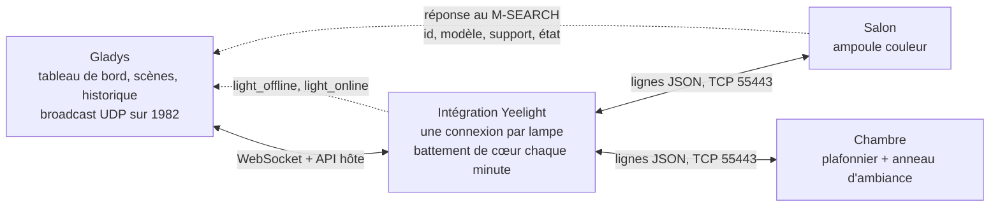
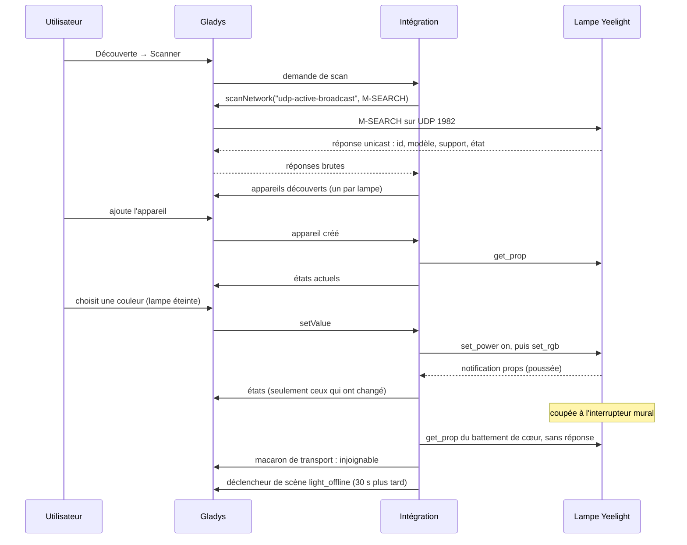
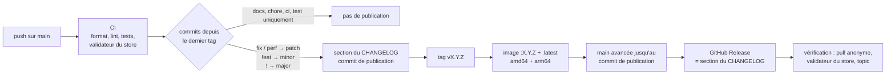

[English](README.md) · **Français** · [Deutsch](README.de.md) · [Español](README.es.md)

# gladys-yeelight

[](LICENSE)
[](https://github.com/William-De71/gladys-yeelight/releases)
[](https://github.com/William-De71/gladys-yeelight/actions/workflows/release.yml)
[](https://gladysassistant.com)


Intégration externe [Gladys Assistant](https://gladysassistant.com) pour les lampes Wi-Fi **Yeelight** — ampoules, rubans LED, lampes de chevet et plafonniers — sur le réseau local. Installée depuis le store en un clic, elle dialogue directement avec vos lampes grâce au protocole officiel de contrôle LAN de Yeelight : pas de compte cloud, pas de passerelle, aucune dépendance d'exécution en dehors du [SDK d'intégration Gladys](https://github.com/GladysAssistant/integration-sdk-js). Les lampes sont trouvées par un scan réseau, leurs fonctionnalités suivent ce que chaque firmware annonce, et chaque changement d'état parvient à Gladys à l'instant où il se produit — interrupteur mural et application Yeelight compris.

📖 Documentation utilisateur : [English](docs/en.md) — [Français](docs/fr.md) — [Deutsch](docs/de.md) — [Español](docs/es.md)

> **Prérequis :** « Contrôle LAN » doit être activé sur chaque lampe, dans l'application Yeelight. Une lampe sans cette option refuse toute commande locale et n'est pas découvrable. C'est la première cause de « aucune lampe trouvée ».

## Fonctionnalités

- **Découverte automatique** : un seul scan trouve toutes les lampes du sous-réseau, avec leur nom, leur modèle, leurs capacités et leur état actuel ; rien à saisir.
- **Fonctionnalités lues dans le firmware** : allumage, luminosité, couleur, température de couleur, lumière d'ambiance et veilleuse, créées seulement si la lampe les annonce (tableau ci-dessous).
- **Temps réel** : les lampes poussent leurs changements sur une connexion maintenue ouverte ; seules les valeurs qui ont changé sont envoyées à Gladys.
- **Interrupteur mural détecté** : une lampe coupée à l'interrupteur apparaît injoignable en une à deux minutes, et revient d'elle-même.
- **Scènes** : démarrez une scène quand une lampe passe hors ligne ou revient, et lancez un effet lumineux depuis une scène — lever de soleil, coucher de soleil, alerte, notification, bougie.
- **Ménage les lampes** : une connexion par lampe et un quota de commandes que l'intégration s'impose, sous les limites du protocole.
- **Quatre langues** : anglais, français, allemand et espagnol, dans Gladys comme dans la documentation.

## Fonctionnement




Du scan à une commande, un état et une scène :



### Découverte : pourquoi pas SSDP


Yeelight utilise un protocole _inspiré_ de SSDP sur le **port 1982**, et non le SSDP standard sur 1900 — la spécification explique avoir quitté le 1900 pour épargner aux appareils sur batterie le flot de multicast générique. Le scanner `ssdp` générique du core ne verrait donc jamais une lampe.

La découverte passe plutôt par la capture `udp-active-broadcast` : l'intégration forge le M-SEARCH, le core le diffuse depuis le réseau de l'hôte (un conteneur en bridge ne le peut pas) et relaie les réponses unicast brutes.

```json
"network_discovery": [{ "type": "udp-active-broadcast", "ports": [1982] }]
```

Une seule réponse porte déjà l'identifiant, le modèle, la liste `support` **et** l'état complet : un scan suffit donc à construire un appareil complet, sans aller-retour TCP.

Les lampes sur un autre sous-réseau ou VLAN — qu'aucun broadcast n'atteint — sont déclarées à la main et interrogées en TCP. L'identifiant d'usine ne peut pas être lu ainsi : une telle lampe est identifiée par son adresse (`manual-<ip>`), et la documentation demande une réservation DHCP. Une adresse déclarée à la main que le scan a aussi trouvée n'est pas interrogée : l'identité du scan l'emporte et la lampe n'apparaît qu'une fois.

### Commandes et contraintes du protocole


Trois limites de la spécification façonnent le code, et toutes trois échouent _en silence_ quand on les dépasse :

- **4 connexions simultanées** par lampe — d'où une seule connexion partagée par lampe, jamais une par commande. Les appelants concurrents (rafraîchissement au démarrage, poll, commande, action de scène) partagent la connexion en cours d'ouverture au lieu de se disputer l'ouverture de plusieurs ;
- **60 commandes par minute** par connexion — imposées par le silence de la lampe, pas par une erreur : le client se limite donc lui-même sur une fenêtre glissante (les rafales restent instantanées, seul un vrai flot attend). Un pas de curseur coûte une commande : l'état d'allumage est mis en cache à partir des notifications au lieu d'être demandé à chaque fois ;
- **couleur, température et luminosité sont refusées quand la lampe est éteinte** — ces commandes sont marquées `requiresPower`, et la lampe est d'abord allumée (en se connectant si besoin), mais seulement si elle est réellement éteinte, car un `set_power` inutile relance le fondu.

Les commandes d'allumage sont relues après le fondu : elles changent des fonctionnalités que rien ne pousse (un anneau d'ambiance qui suit la lumière principale, la veilleuse qui modifie la luminosité).

## Lampes prises en charge

Les fonctionnalités dépendent de l'en-tête `support` que chaque lampe annonce, pas d'une table de modèles codée en dur : un modèle sorti après l'écriture de ce code obtient donc exactement les fonctionnalités que son firmware implémente. Le modèle ne décide que de la plage en Kelvin du curseur de température, et des quelques firmwares connus pour annoncer une méthode qu'ils ignorent.

| Capacité                       | Nom de la fonctionnalité dans Gladys            | Créée quand la lampe annonce                            |
| ------------------------------ | ----------------------------------------------- | ------------------------------------------------------- |
| Allumer / éteindre             | On/Off — Main light avec une lumière d'ambiance | toujours                                                |
| Luminosité (1-100 %)           | Brightness — Main brightness                    | `set_bright`                                            |
| Couleur (0xRRGGBB)             | Colour — Main colour                            | `set_rgb`                                               |
| Température de couleur (mired) | Colour temperature — Main colour temperature    | `set_ct_abx` — sauf les rubans RVB seulement (`strip6`) |
| Lumière d'ambiance             | Ambient light                                   | `bg_set_power`                                          |
| Luminosité d'ambiance          | Ambient brightness                              | `bg_set_bright`                                         |
| Couleur d'ambiance             | Ambient colour                                  | `bg_set_rgb`                                            |
| Température d'ambiance         | Ambient colour temperature                      | `bg_set_ct_abx`                                         |
| Veilleuse (mode lune)          | Night light                                     | modèles plafonniers                                     |

Les noms des fonctionnalités sont fixés par l'intégration, en anglais, quelle que soit la langue de Gladys ; chacun peut être renommé dans Gladys. La température de couleur est publiée en **mired**, comme dans les intégrations Philips Hue et Tasmota du core : Gladys dessine le curseur avec un dégradé froid→chaud, que le mired suit et que le Kelvin parcourt à l'envers. Les valeurs sont converties à la frontière, dans la plage du modèle (2700–6500 K sur un plafonnier, 1700–6500 K sur une ampoule couleur).

## Configuration

| Champ                      | Défaut | Usage                                                                                                                |
| -------------------------- | ------ | -------------------------------------------------------------------------------------------------------------------- |
| Durée de transition (ms)   | 500    | Fondu appliqué à chaque changement (0 à 5000) ; 0 pour un changement instantané                                      |
| Lampes ajoutées à la main  | vide   | `192.168.1.42`, `192.168.1.43:55443` ou `[fe80::1]`, séparées par une virgule, pour une lampe hors de portée du scan |
| Durée de la découverte (s) | 5      | Durée d'écoute des réponses au scan (3 à 30)                                                                         |

Actions de la page de l'intégration : **Tester la connexion** (une découverte complète, avec le nombre de lampes et de fonctionnalités) et **Reconnecter les lampes** (ferme puis rouvre toutes les connexions, après une coupure de courant ou un changement de réseau).

## Transport

Yeelight est uniquement local : le manifeste déclare `"transports": ["local"]`, et chaque appareil porte un macaron de transport — **Local** tant que sa lampe est connectée, **Injoignable** sinon.

Une lampe coupée à l'interrupteur mural ne ferme jamais sa connexion TCP : la socket reste à moitié ouverte et plus rien n'arrive, si bien que sans sonde la lampe semblerait connectée pendant des heures. Un **battement de cœur** demande donc son état d'allumage à toute connexion silencieuse depuis une minute — une commande par minute et par lampe, sur un quota de 60. Sans réponse sous 5 secondes, la connexion est fermée : le macaron passe à **Injoignable** en une à deux minutes, et l'intégration se reconnecte en espaçant ses essais (de 5 secondes à 5 minutes) jusqu'à ce que la lampe soit de nouveau alimentée.

Les états arrivent dans Gladys par les notifications des lampes et sont publiés avec `publishChangedStates` : une valeur qui n'a pas changé n'est pas renvoyée (elle l'est une fois par heure). Les appareils que vous avez créés sont lus une fois au démarrage et à leur ajout, car une lampe ne pousse que ce qui _change_ ; `onPoll` n'est qu'un filet de sécurité qui reconnecte une lampe dont la session est tombée.

## Scènes

| Déclencheur               | Quand                                                                                                 | Filtres | Variables                                     |
| ------------------------- | ----------------------------------------------------------------------------------------------------- | ------- | --------------------------------------------- |
| Lampe Yeelight hors ligne | Une lampe est restée injoignable 30 secondes (interrupteur mural, coupure de courant, problème Wi-Fi) | lampe   | `light`, `name`, `address`                    |
| Lampe Yeelight de retour  | Cette lampe répond de nouveau                                                                         | lampe   | `light`, `name`, `address`, `offline_minutes` |

| Action                              | Champs                                                              | Sorties      |
| ----------------------------------- | ------------------------------------------------------------------- | ------------ |
| Yeelight : lancer un effet lumineux | lampe, effet, durée en minutes (1 à 60, lever et coucher de soleil) | `light_name` |
| Yeelight : arrêter l'effet lumineux | lampe                                                               | `light_name` |

Les déclencheurs ne concernent que les lampes que vous avez ajoutées à Gladys, et se déclenchent une fois par transition : une lampe éteinte puis rallumée en moins de 30 secondes ne déclenche rien, et **de retour** ne suit qu'un **hors ligne** déclenché. Laissez le filtre de lampe vide pour surveiller toutes les lampes. Une action de scène ne déclenche jamais de déclencheur : un effet change les états d'une lampe, jamais sa joignabilité.

| Effet                             | Ce que fait la lampe                                                                            |
| --------------------------------- | ----------------------------------------------------------------------------------------------- |
| Lever de soleil (reste allumée)   | D'un orange profond à 1 % jusqu'à un blanc neutre à 100 %, sur la durée choisie ; reste allumée |
| Coucher de soleil (finit éteinte) | D'un blanc chaud jusqu'à un orange profond à 1 %, sur la durée choisie ; puis s'éteint          |
| Alerte : flashs rouges            | 10 flashs rouges (5 s), puis retour à son état précédent — ou éteinte si elle l'était           |
| Notification : pulsations bleues  | 4 pulsations bleues douces (5 s), puis retour à son état précédent — ou éteinte si elle l'était |
| Bougie (jusqu'à l'arrêt)          | Un scintillement ambré, jusqu'à **Yeelight : arrêter l'effet lumineux** ou une autre commande   |

L'effet est un flux de couleurs Yeelight (`set_scene cf`) : il s'exécute dans la lampe elle-même, si bien qu'un lever de soleil de 30 minutes continue même si Gladys redémarre. Une lampe blanche seulement (plafonnier, lampe de bureau) joue le même effet en température de couleur : un flash blanc froid pour l'alerte, un scintillement chaud pour la bougie.

Trois scènes pour commencer :

- **Se réveiller avec le soleil** : déclencheur **Déclenchement programmé** à 6 h 45 les jours de semaine ; action **Yeelight : lancer un effet lumineux** avec la lampe `Chambre`, l'effet **Lever de soleil (reste allumée)**, la durée `20`.
- **Une lampe coupée au mur** : déclencheur **Lampe Yeelight hors ligne**, lampe vide (toutes les lampes) ; action **Envoyer un message** « _Nom de la lampe_ a été coupée à l'interrupteur », en insérant la variable **Nom de la lampe**. Ajoutez **Lampe Yeelight de retour** avec la variable **Minutes hors ligne** pour savoir combien de temps elle est restée coupée.
- **Une notification discrète** : déclencheur **Changement d'état de l'appareil** sur la prise du lave-linge, puissance sous 5 W ; action **Yeelight : lancer un effet lumineux** avec la lampe `Salon`, l'effet **Notification : pulsations bleues**. Une lampe éteinte se rééteint ensuite.

## Installation

1. Dans Gladys (**5.1.0 ou plus récent**) : **Intégrations**, cherchez **Yeelight** dans le store, installez-la.
2. Dans l'application Yeelight, activez **Contrôle LAN** sur chaque lampe.
3. **Découverte → Scanner**, puis ajoutez les lampes de votre choix.

Depuis les déclencheurs et actions de scène, l'intégration exige Gladys 5.1.0 : un Gladys plus ancien ne reçoit plus ses mises à jour et reste en version 1.2.1 jusqu'à ce que Gladys lui-même soit mis à jour. La [documentation utilisateur](docs/fr.md) détaille les prérequis réseau, les lampes ajoutées à la main, les plafonniers à anneau d'ambiance, les scènes et la résolution de problèmes.

## Développement

```bash
npm install
GLADYS_HOST_API_URL="http://localhost:1443" \
GLADYS_INTEGRATION_TOKEN="<token>" \
npm start
```

```
index.js                     câblage du SDK uniquement : createApp(new GladysIntegration()) + connect
src/
  app.js                     tous les handlers (découverte, commandes, poll, actions, appareil créé)
  events.js                  déclencheurs de scène : light_offline, light_online (délai de grâce 30 s)
  scenes.js                  actions de scène : start_effect, stop_effect
  config.js                  normalisation de la configuration, lampes déclarées à la main, adresses
  devices.js                 découverte, publication des états (publishChangedStates), commandes
  messages.js                messages affichés à l'utilisateur, en en / fr / de / es
  yeelight/
    YeelightManager.js       une connexion vivante par lampe, reconnexion espacée, battement de cœur
    YeelightClient.js        le protocole LAN : trames, corrélation, quota
    discovery.js             construction du M-SEARCH et analyse des réponses
    effects.js               effets lumineux en flux de couleurs (set_scene cf)
    mapping.js               capacités de la lampe -> descripteurs de fonctionnalités Gladys
    models.js                analyse de la liste support, plages Kelvin par modèle
    convert.js               traduction des valeurs, dans les deux sens
    constants.js             constantes du protocole, délais, schéma des identifiants externes
```

L'identifiant de plateforme est l'**id** de la lampe renvoyé par la découverte (`0x000000000015243f`), gravé en usine. Une adresse IP est un bail DHCP : elle vit donc dans un paramètre de l'appareil :

```
device : ext:<selector>:yeelight:<bulbId>
feature: ext:<selector>:yeelight:<bulbId>:<featureKey>
```

**Push, pas de poll.** Les lampes Yeelight poussent leurs changements d'état sur la connexion maintenue ouverte : une lampe réglée à l'interrupteur mural ou depuis l'application Yeelight met Gladys à jour immédiatement, et aucune fonctionnalité ne déclare de `poll_frequency`.

**Une lampe a quatre emplacements de connexion.** Les tentatives de connexion à une même lampe sont partagées, une lampe trouvée par le scan _et_ déclarée à la main garde une seule connexion, et chaque connexion est fermée à l'arrêt, ce qui libère son emplacement aussitôt.

Le canal de contrôle est en texte brut : une lampe se pilote donc à la main pendant le développement :

```bash
telnet <ip-de-la-lampe> 55443
{"id":1,"method":"set_power","params":["on","smooth",500]}
```

## Tests

```bash
npm test               # node --test, ne touche jamais au réseau
npm run lint           # ESLint
npm run format:check   # Prettier, comme le lance la CI
npx github:GladysAssistant/integration-store . --skip-image-check
```

`test/structure.test.js` compare la découverte à `test/fixtures/discovery.baseline.json`, généré depuis la v1.2.1 avec une ampoule couleur, un plafonnier à anneau d'ambiance et veilleuse, un ruban RVB seulement, une ampoule blanche et une lampe ajoutée à la main : un identifiant externe, une catégorie, un type, une unité ou une borne qui change obligerait les utilisateurs à recréer leurs appareils. `test/app.test.js` pilote les handlers avec le faux Gladys du SDK, et `test/i18n.test.js` vérifie les quatre langues du manifeste, des messages, des docs et de ces README.

## Publication

Les publications sont automatiques. Chaque push sur `main` lance la CI, puis calcule la version suivante à partir des Conventional Commits depuis le dernier tag :



Le manifeste n'arrive sur `main` qu'une fois son image disponible, si bien que le store n'annonce jamais une version qu'il ne peut pas télécharger. `CHANGELOG.md` est généré : ne le modifiez jamais à la main. **Actions → Release → Run workflow** propose `release-as` (forcer une version) et `dry-run` (afficher la version et les notes sans publier).

Les titres de commit et de pull request suivent les [Conventional Commits](https://www.conventionalcommits.org/), en anglais, rédigés comme la ligne du changelog que l'utilisateur lira : `feat(scenes): start a scene when a Yeelight light goes offline`. `feat` publie une version mineure, `fix` et `perf` un correctif, `!` ou un pied de commit `BREAKING CHANGE:` une version majeure ; `docs`, `chore`, `ci`, `test`, `style`, `refactor` et `build` seuls ne publient rien.

Si `main` est protégée (règle de protection de branche ou ruleset), le workflow ne peut l'avancer jusqu'au commit de publication que si **GitHub Actions** est autorisé à contourner la règle (Settings → Rules → Bypass list), ou avec le jeton d'une GitHub App ; sinon le tag et l'image sont publiés mais `main` reste en arrière.

## Résolution de problèmes

| Symptôme                                     | Cause probable                                                                                                       |
| -------------------------------------------- | -------------------------------------------------------------------------------------------------------------------- |
| Aucune lampe trouvée                         | « Contrôle LAN » n'est pas activé dans l'application Yeelight — à vérifier en premier                                |
| Une seule lampe sur plusieurs est trouvée    | L'option n'est activée que sur cette lampe — elle se règle lampe par lampe                                           |
| Une lampe n'est jamais trouvée par le scan   | Elle est sur un autre sous-réseau ou VLAN que Gladys : le broadcast ne franchit pas un routeur, ajoutez-la à la main |
| Appareil « Injoignable »                     | Lampe coupée à l'interrupteur, éteinte ou hors de portée Wi-Fi : elle se reconnecte d'elle-même                      |
| Une lampe ajoutée à la main devient inconnue | Son adresse IP a changé — donnez-lui une adresse fixe dans votre routeur                                             |
| Les commandes ne passent plus après un temps | Une autre application occupe les 4 connexions de la lampe, ou épuise ses 60 commandes par minute                     |
| L'action d'effet échoue                      | La lampe ne prend pas en charge les effets, ou elle est injoignable à ce moment-là                                   |

Journaux : l'onglet **Supervision** de l'intégration ; ajoutez `DEBUG=gladys-integration-sdk` au conteneur pour le détail du SDK.

## Contribuer

Les issues et pull requests sont les bienvenues : [signaler un bug](https://github.com/William-De71/gladys-yeelight/issues/new?template=bug_report.yml) (versions de Gladys et de l'intégration, modèle et firmware de la lampe, journaux) ou [proposer une fonctionnalité](https://github.com/William-De71/gladys-yeelight/issues/new?template=feature_request.yml). Retours et questions sont aussi les bienvenus sur le [fil du forum](https://community.gladysassistant.com/t/10689). Problèmes de sécurité : voir [SECURITY.md](SECURITY.md).

Implémente la [Yeelight WiFi Light Inter-Operation Specification](https://www.yeelight.com/download/Yeelight_Inter-Operation_Spec.pdf) avec le module `net` de Node.js, et rien d'autre. Construite sur le [SDK d'intégration Gladys](https://github.com/GladysAssistant/integration-sdk-js), à partir du [modèle officiel](https://github.com/GladysAssistant/integration-template-js).

## Licence

[Apache-2.0](LICENSE) — voir aussi [NOTICE](NOTICE). Yeelight est une marque de son propriétaire ; ce projet n'est ni affilié à Yeelight ou Xiaomi, ni approuvé ou soutenu par eux.
