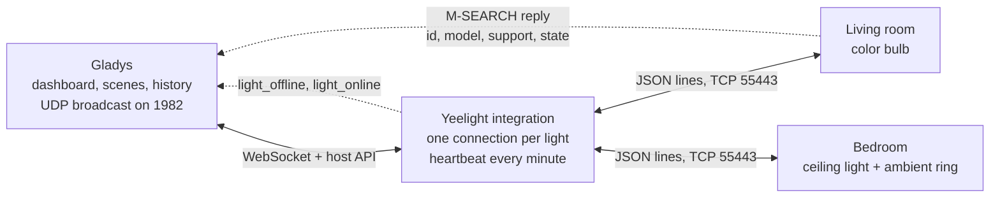
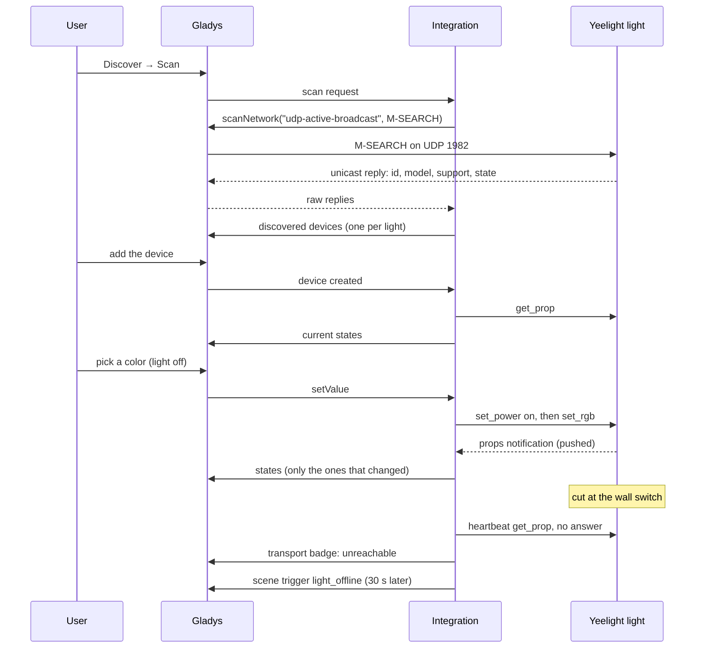
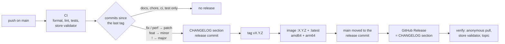

**English** · [Français](README.fr.md) · [Deutsch](README.de.md) · [Español](README.es.md)

# gladys-yeelight

[](LICENSE)
[](https://github.com/William-De71/gladys-yeelight/releases)
[](https://github.com/William-De71/gladys-yeelight/actions/workflows/release.yml)
[](https://gladysassistant.com)


External [Gladys Assistant](https://gladysassistant.com) integration for **Yeelight** Wi-Fi lights — bulbs, LED strips, bedside lamps and ceiling lights — over the local network. Installed from the store in one click, it talks to your lights directly through the official Yeelight LAN control protocol: no cloud account, no gateway, no runtime dependency beyond the [Gladys integration SDK](https://github.com/GladysAssistant/integration-sdk-js). Lights are found by a network scan, their features follow what each firmware advertises, and every state change reaches Gladys the moment it happens — wall switch and Yeelight app included.

📖 User documentation: [English](docs/en.md) — [Français](docs/fr.md) — [Deutsch](docs/de.md) — [Español](docs/es.md)

> **Prerequisite:** "LAN Control" must be enabled on each light, in the Yeelight app. A light without it refuses every local command and is not discoverable. It is the first cause of "no light found".

## Features

- **Automatic discovery**: one scan finds every light of the subnet, with its name, model, capabilities and current state; nothing to type.
- **Features read from the firmware**: on/off, brightness, color, color temperature, ambient light and night light, created only when the light advertises them (table below).
- **Real time**: lights push their changes over a connection kept open; only the values that changed are sent to Gladys.
- **Wall switch detected**: a light cut at the wall switch shows up as unreachable within one to two minutes, and comes back on its own.
- **Scenes**: start a scene when a light goes offline or comes back, and play a light effect from a scene — sunrise, sunset, alert, notification, candle.
- **Spares the lights**: one connection per light and a self-imposed command quota, below the limits of the protocol.
- **Four languages**: English, French, German and Spanish, in Gladys and in the documentation.

## How it works




From the scan to a command, a state and a scene:



### Discovery: why not SSDP


Yeelight uses an SSDP-_like_ protocol on **port 1982**, not standard SSDP on 1900 — the spec explains they moved off 1900 to spare battery-powered devices the generic multicast flood. The core's generic `ssdp` scanner would therefore never see a light.

Discovery goes through the `udp-active-broadcast` capture instead: the integration forges the M-SEARCH, the core broadcasts it from the host network (a bridge container cannot) and relays the raw unicast replies.

```json
"network_discovery": [{ "type": "udp-active-broadcast", "ports": [1982] }]
```

A single reply already carries the id, the model, the support list **and** the full state, so a scan alone builds a complete device with no TCP round-trip.

Lights on another subnet or VLAN — which no broadcast reaches — are declared by hand and probed over TCP. The factory id cannot be read that way, so such a light is identified by its address (`manual-<ip>`), and the docs ask for a DHCP reservation. A hand-declared address the scan also found is not probed: the scan identity wins and the light is listed once.

### Commands and protocol constraints


Three limits from the spec shape the code, and all three fail _silently_ when violated:

- **4 simultaneous connections** per light — hence one shared connection per light, never one per command. Concurrent callers (startup refresh, poll, command, scene action) share the connection being opened instead of racing to open several;
- **60 commands per minute** per connection — enforced by the light going quiet, not by an error, so the client rate-limits itself over a sliding window (bursts stay instant, only a genuine flood waits). A slider step costs one command: the power state is cached from the pushes instead of being queried each time;
- **color, temperature and brightness are refused while the light is off** — those commands are flagged `requiresPower`, and the light is switched on first (connecting if needed), but only when it is actually off, since a needless `set_power` restarts the fade.

Power commands are read back after the fade: they move features nothing pushes (an ambient ring following the main light, night light changing the brightness).

## Supported lights

Features are keyed on the `support` header each light advertises, not on a hardcoded model table — so a model released after this code was written still gets exactly the features its firmware implements. The model only decides the Kelvin range of the temperature slider, and the few firmwares known to advertise a method they ignore.

| Capability                   | Feature name in Gladys                       | Created when the light advertises                |
| ---------------------------- | -------------------------------------------- | ------------------------------------------------ |
| On / off                     | On/Off — Main light with an ambient light    | always                                           |
| Brightness (1-100 %)         | Brightness — Main brightness                 | `set_bright`                                     |
| Color (0xRRGGBB)             | Colour — Main colour                         | `set_rgb`                                        |
| Color temperature (mired)    | Colour temperature — Main colour temperature | `set_ct_abx` — except RGB-only strips (`strip6`) |
| Ambient light on / off       | Ambient light                                | `bg_set_power`                                   |
| Ambient brightness           | Ambient brightness                           | `bg_set_bright`                                  |
| Ambient color                | Ambient colour                               | `bg_set_rgb`                                     |
| Ambient color temperature    | Ambient colour temperature                   | `bg_set_ct_abx`                                  |
| Night light (moonlight mode) | Night light                                  | ceiling models                                   |

Feature names are set by the integration in English, whatever the language of Gladys; each one can be renamed in Gladys. The color temperature is published in **mired**, like the core's Philips Hue and Tasmota integrations: Gladys draws the slider with a cold→warm gradient, which mired follows and Kelvin runs against. Values are converted at the boundary, within the range of the model (2700–6500 K on a ceiling light, 1700–6500 K on a color bulb).

## Configuration

| Field                    | Default | Use                                                                                                     |
| ------------------------ | ------- | ------------------------------------------------------------------------------------------------------- |
| Transition duration (ms) | 500     | Fade applied to every change (0 to 5000); 0 for an instant change                                       |
| Lights added by hand     | empty   | `192.168.1.42`, `192.168.1.43:55443` or `[fe80::1]`, comma-separated, for a light the scan cannot reach |
| Discovery duration (s)   | 5       | How long the scan listens for replies (3 to 30)                                                         |

Actions of the integration page: **Test the connection** (a full discovery, with the number of lights and features) and **Reconnect the lights** (closes and reopens every connection, after a power cut or a network change).

## Transport

Yeelight is local only: the manifest declares `"transports": ["local"]`, and each device carries a transport badge — **Local** while its light is connected, **Unreachable** while it is not.

A light cut at the wall switch never closes its TCP connection: the socket stays half-open and nothing arrives, so without a probe the light would look connected for hours. A **heartbeat** therefore asks every connection silent for one minute for its power state — one command per minute and per light, against a quota of 60. No answer within 5 seconds drops the connection: the badge turns **Unreachable** within one to two minutes, and the integration reconnects with a growing delay (5 seconds up to 5 minutes) until the light is powered again.

States reach Gladys from the pushes of the lights and are published with `publishChangedStates`: a value that did not change is dropped (sent again once an hour). The devices you created are read once at startup and when you add them, since a light only pushes what _changes_; `onPoll` is only a safety net that reconnects a light whose session dropped.

## Scenes

| Trigger                    | When                                                                              | Filters | Variables                                     |
| -------------------------- | --------------------------------------------------------------------------------- | ------- | --------------------------------------------- |
| Yeelight light offline     | A light stayed unreachable for 30 seconds (wall switch, power cut, Wi-Fi problem) | light   | `light`, `name`, `address`                    |
| Yeelight light back online | That light answers again                                                          | light   | `light`, `name`, `address`, `offline_minutes` |

| Action                          | Fields                                                           | Outputs      |
| ------------------------------- | ---------------------------------------------------------------- | ------------ |
| Yeelight: play a light effect   | light, effect, duration in minutes (1 to 60, sunrise and sunset) | `light_name` |
| Yeelight: stop the light effect | light                                                            | `light_name` |

Triggers only concern the lights you added to Gladys, and fire once per transition: a light switched off and on again within 30 seconds fires nothing, and **back online** only follows a fired **offline**. Leave the light filter empty to watch every light. A scene action never fires a trigger: an effect changes the states of a light, never its reachability.

| Effect                    | What the light does                                                                   |
| ------------------------- | ------------------------------------------------------------------------------------- |
| Sunrise (ends on)         | Deep orange at 1 % up to a neutral white at 100 %, over the chosen duration; stays on |
| Sunset (ends off)         | Warm white down to a deep orange at 1 %, over the chosen duration; then turns off     |
| Alert: red flashes        | 10 red flashes (5 s), then back to its previous state — or off if it was off          |
| Notification: blue pulses | 4 soft blue pulses (5 s), then back to its previous state — or off if it was off      |
| Candle (until stopped)    | An amber flicker, until **Yeelight: stop the light effect** or any other command      |

The effect is a Yeelight color flow (`set_scene cf`): it runs inside the light itself, so a 30-minute sunrise keeps going even if Gladys restarts. A white-only light (ceiling light, desk lamp) plays the same effect in color temperature: a cold white flash for the alert, a warm flicker for the candle.

Three scenes to start with:

- **Wake up with the sun**: trigger **Scheduled trigger** at 6:45 on weekdays; action **Yeelight: play a light effect** with light `Bedroom`, effect **Sunrise (ends on)**, duration `20`.
- **A light cut at the wall**: trigger **Yeelight light offline**, light empty (every light); action **Send Message** "_Light name_ was switched off at the wall switch", inserting the variable **Light name**. Add **Yeelight light back online** with the variable **Minutes offline** to know how long it stayed off.
- **A discreet notification**: trigger **Device state change** on the washing machine plug, power below 5 W; action **Yeelight: play a light effect** with light `Living room`, effect **Notification: blue pulses**. A light that was off turns back off afterwards.

## Installation

1. In Gladys (**5.3.0 or newer**): **Integrations → Store**, search for **Yeelight**, install.
2. In the Yeelight app, enable **LAN Control** on each light.
3. **Discover → Scan**, then add the lights you want.

The integration requires Gladys 5.3.0 (scene triggers and actions since 5.1.0, catalog keywords and countries since 5.3.0): an older Gladys no longer receives its updates and stays on version 1.4.1 (1.3.0 before Gladys 5.1.0) until Gladys itself is updated. The [user documentation](docs/en.md) details the network requirements, the lights added by hand, the ceiling lights with an ambient ring, the scenes and the troubleshooting.

## Development

```bash
npm install
GLADYS_HOST_API_URL="http://localhost:1443" \
GLADYS_INTEGRATION_TOKEN="<token>" \
npm start
```

```
index.js                     SDK wiring only: createApp(new GladysIntegration()) + connect
src/
  app.js                     every handler (discovery, commands, poll, actions, device created)
  events.js                  scene triggers: light_offline, light_online (30 s grace)
  scenes.js                  scene actions: start_effect, stop_effect
  config.js                  config normalization, hand-declared lights, addresses
  devices.js                 discovery, state publishing (publishChangedStates), commands
  messages.js                user-facing messages, in en / fr / de / es
  yeelight/
    YeelightManager.js       one live connection per light, reconnection backoff, heartbeat
    YeelightClient.js        the LAN protocol: framing, correlation, quota
    discovery.js             M-SEARCH forging and reply parsing
    effects.js               light effects as color flows (set_scene cf)
    mapping.js               bulb capabilities -> Gladys feature descriptors
    models.js                support list parsing, per-model Kelvin ranges
    convert.js               value translation, both directions
    constants.js             protocol constants, timings, external-id scheme
```

The platform id is the light **id** reported in discovery (`0x000000000015243f`), burned in at the factory. An IP address is a DHCP lease, so it lives in a device param instead:

```
device : ext:<selector>:yeelight:<bulbId>
feature: ext:<selector>:yeelight:<bulbId>:<featureKey>
```

**Push, not poll.** Yeelight lights push their state changes over the connection kept open: a light dimmed at the wall switch or from the Yeelight app updates Gladys immediately, and no feature declares a `poll_frequency`.

**A light has four connection slots.** Connection attempts to one light are shared, a light found by the scan _and_ declared by hand keeps a single connection, and every connection is closed on shutdown, freeing its slot right away.

The control channel is plain text, so a light can be driven by hand while developing:

```bash
telnet <light-ip> 55443
{"id":1,"method":"set_power","params":["on","smooth",500]}
```

## Tests

```bash
npm test               # node --test, never touches the network
npm run lint           # ESLint
npm run format:check   # Prettier, as the CI runs it
npx github:GladysAssistant/integration-store . --skip-image-check
```

`test/structure.test.js` compares the discovery with `test/fixtures/discovery.baseline.json`, generated from v1.3.0 with a color bulb, a ceiling light with an ambient ring and a night light, an RGB-only strip, a white bulb and a light added by hand: an external id, a category, a type, a unit or a bound that changes would force users to recreate their devices. `test/app.test.js` drives the handlers with the fake Gladys of the SDK, and `test/i18n.test.js` checks the four languages of the manifest, the messages, the docs and these READMEs.

## Release

Releases are automatic. Every push on `main` runs the CI, then computes the next version from the Conventional Commits since the last tag:



The manifest only reaches `main` once its image exists, so the store never announces a version it cannot pull. `CHANGELOG.md` is generated: never edit it by hand. **Actions → Release → Run workflow** offers `release-as` (force a version) and `dry-run` (show the version and the notes without publishing).

Commit and pull request titles follow [Conventional Commits](https://www.conventionalcommits.org/), in English, written as the changelog line the user will read: `feat(scenes): start a scene when a Yeelight light goes offline`. `feat` publishes a minor version, `fix` and `perf` a patch, `!` or a `BREAKING CHANGE:` footer a major; `docs`, `chore`, `ci`, `test`, `style`, `refactor` and `build` alone publish nothing.

If `main` is protected (branch protection rule or ruleset), the workflow can only move it to the release commit when **GitHub Actions** is allowed to bypass the rule (Settings → Rules → Bypass list), or with a GitHub App token; otherwise the tag and the image are published but `main` stays behind.

## Troubleshooting

| Symptom                                | Likely cause                                                                                         |
| -------------------------------------- | ---------------------------------------------------------------------------------------------------- |
| No light found                         | "LAN Control" is not enabled in the Yeelight app — check this first                                  |
| Only one light out of several is found | The option is only enabled on that one — it is set per light                                         |
| A light is never found by the scan     | It sits on another subnet or VLAN than Gladys: the broadcast does not cross a router, add it by hand |
| Device "Unreachable"                   | Light cut at the wall switch, powered off or out of Wi-Fi range: it reconnects on its own            |
| A hand-added light becomes unknown     | Its IP address changed — give it a fixed address in your router                                      |
| Commands stop working after a while    | Another app holds the 4 connection slots of the light, or floods its 60 commands per minute          |
| The effect action fails                | The light does not support effects, or it is unreachable at that moment                              |

Logs: the **Supervision** tab of the integration; add `DEBUG=gladys-integration-sdk` to the container for the SDK details.

## Contributing

Issues and pull requests are welcome: [bug report](https://github.com/William-De71/gladys-yeelight/issues/new?template=bug_report.yml) (Gladys and integration versions, light model and firmware, logs) or [feature request](https://github.com/William-De71/gladys-yeelight/issues/new?template=feature_request.yml). Feedback and questions also go to the [forum thread](https://community.gladysassistant.com/t/10689). Security problems: see [SECURITY.md](SECURITY.md).

Implements the [Yeelight WiFi Light Inter-Operation Specification](https://www.yeelight.com/download/Yeelight_Inter-Operation_Spec.pdf) on the Node.js `net` and nothing else. Built on the [Gladys integration SDK](https://github.com/GladysAssistant/integration-sdk-js), from the [official template](https://github.com/GladysAssistant/integration-template-js).

## License

[Apache-2.0](LICENSE) — see also [NOTICE](NOTICE). Yeelight is a trademark of its owner; this project is not affiliated with, endorsed by or sponsored by Yeelight or Xiaomi.
